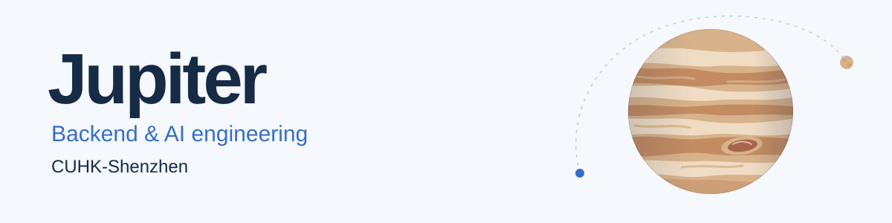
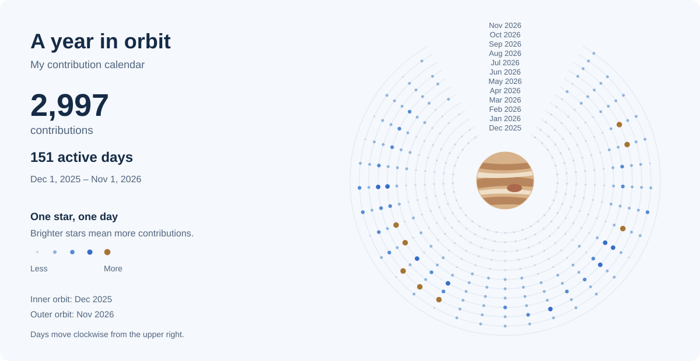

<picture>
  <source media="(prefers-color-scheme: dark)" srcset="assets/jupiter-dark.svg">
  
</picture>

  <a href="#selected-projects">Projects</a> &nbsp; / &nbsp;
  <a href="#open-source">Open source</a> &nbsp; / &nbsp;
  <a href="#a-year-in-orbit">Activity</a>

I'm **Jupiter**, a graduate student at **CUHK-Shenzhen** and a backend development engineer. I build AI applications and agent harnesses, with a focus on reliable LLM systems.

My work spans backend workflows, human review, MCP, and LLM gateways.

## Selected projects

### [AfterSaleFlow-Agent](https://github.com/Jupiter363/AfterSaleFlow-Agent)

A human-review-gated system for order fulfillment disputes. My work on agent harnesses, backend workflows, and AI applications in a single project.

### [shortlink](https://github.com/Jupiter363/shortlink)

A Java short-link service extended with agents for intelligent delivery and analysis.

## Open source

**[Hermes Agent](https://github.com/NousResearch/hermes-agent)** 
Fixed an MCP gateway timeout loop that leaked memory and caused silent OOM crashes. The fix landed upstream with author credit. 
[P0 issue #63892](https://github.com/NousResearch/hermes-agent/issues/63892) · [Upstream commit](https://github.com/NousResearch/hermes-agent/commit/3df8bd3478b96d1665bf390c07630268ae522f7e) · [Merged PR #67183](https://github.com/NousResearch/hermes-agent/pull/67183)

**[Spring AI Alibaba](https://github.com/alibaba/spring-ai-alibaba)** 
Contributions around DashScope integration, Spring AI compatibility, documentation, and RAG behavior. 
[PR #4755](https://github.com/alibaba/spring-ai-alibaba/pull/4755) · [Upstream commit](https://github.com/spring-ai-alibaba/spring-ai-extensions/commit/b894e830633bd99d0e4e007a22a45061ee951bdb)

**[LiteLLM](https://github.com/BerriAI/litellm)** 
Contribution work on MCP protocol edge cases, LLM gateway routing, and passthrough security. 
[PR #32244](https://github.com/BerriAI/litellm/pull/32244)

## Tools I work with

| Backend | AI & agents | Frontend |
| :--- | :--- | :--- |
| Java · Spring AI | Python · LangChain · LangGraph · MCP | Vue |

## A year in orbit

<picture>
  <source media="(max-width: 600px) and (prefers-color-scheme: dark)" srcset="assets/activity-dark-mobile.svg">
  <source media="(max-width: 600px)" srcset="assets/activity-light-mobile.svg">
  <source media="(prefers-color-scheme: dark)" srcset="assets/activity-dark.svg">
  
</picture>

Real contribution data, refreshed daily. <a href="docs/activity.md">How the chart works</a>.

[Merged upstream PRs](https://github.com/search?q=is%3Apr+author%3AJupiter363+-user%3AJupiter363+is%3Amerged&type=pullrequests) · [Under review](https://github.com/search?q=is%3Apr+author%3AJupiter363+-user%3AJupiter363+is%3Aopen&type=pullrequests) · [All upstream PRs](https://github.com/search?q=is%3Apr+author%3AJupiter363+-user%3AJupiter363&type=pullrequests)
